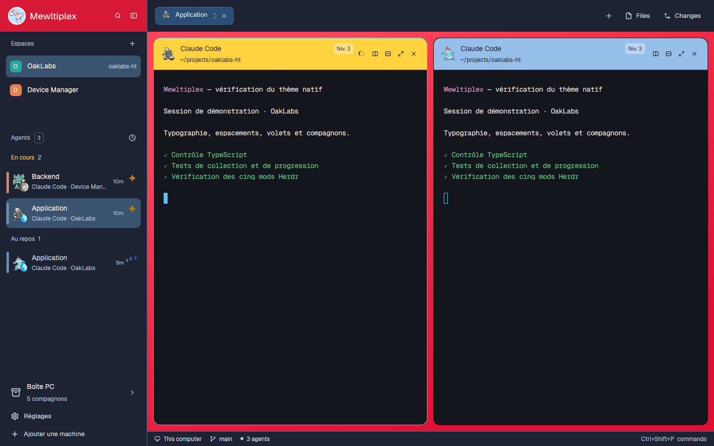
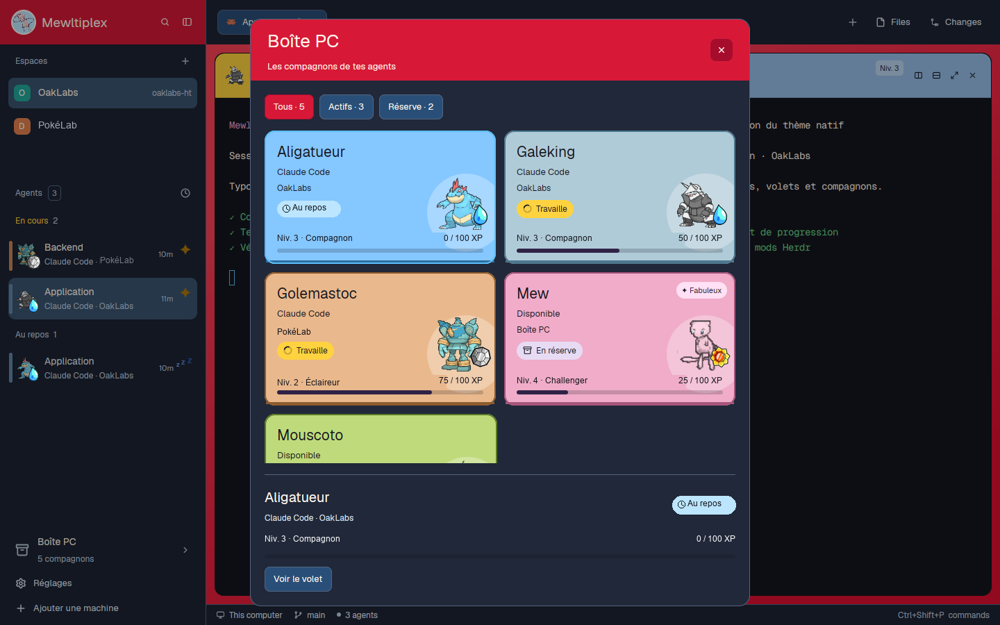

# Pokemon Mewltiplex

[English](README.md)

**Vos agents avancent. Leurs Pokémon aussi.**

Pokemon Mewltiplex donne à [Herdr](https://herdr.dev/) un habillage pop inspiré du Pokédex : un boîtier rouge, des espaces faciles à repérer et un compagnon Pokémon pour chaque agent. Le layout installé s’appelle **Mewltiplex** et suit automatiquement l’apparence claire ou sombre de l’application.



[Voir le mode clair](preview-paper.png) · [Découvrir la Boîte PC](preview-box.png)

## Un peu de jeu dans le travail

- **Un Pokémon par agent**, choisi parmi 1 025 espèces. La liste des agents dans la barre latérale gauche affiche un portrait PMD SpriteCollab lorsqu’il existe ; les onglets, les volets et les notifications conservent leurs sprites actuels.
- **Des statuts qui se lisent d’un coup d’œil** : `!` pour une nouveauté, `?` quand l’agent a besoin de vous, `✦` pendant le travail et `zzz` au repos.
- **Une progression sans clic supplémentaire** : les tours terminés rapportent automatiquement de l’XP et débloquent dix paliers, jusqu’à Maître de la Ligue.
- **Une Boîte PC** pour retrouver les compagnons actifs ou en réserve et réaffecter ceux que vous souhaitez garder près de vous.



Les aperçus utilisent des données fictives et ont été composés localement à partir de captures de Herdr.

## Installation

Compatible avec **Herdr App 0.1.16 ou plus récent** sur Windows, macOS et Linux.

### Avec un agent

Donnez-lui cette consigne :

```text
Lis AGENTS.md dans mon profil Herdr App, puis installe Mewltiplex
depuis https://github.com/Skilldus/oaklabs-ht en suivant README.fr.md.
```

### Depuis le dépôt

Clonez le dépôt, puis lancez le script adapté depuis sa racine, avec `herdr-app` disponible dans le terminal :

**Windows · PowerShell**

```powershell
powershell.exe -NoProfile -ExecutionPolicy Bypass -File .\install.ps1
```

**macOS et Linux**

```sh
sh ./install.sh
```

Si Herdr est ouvert, l’installation active Mewltiplex. Sinon, sélectionnez-le au prochain lancement dans **Settings → Look → Layout**. Pour revenir à l’interface d’origine, choisissez **Herdr** au même endroit.

Pour une mise à jour, lancez `git pull --ff-only` dans le dépôt puis relancez le script d’installation.

### Sons de notification Pokémon

Les sons ne sont pas inclus dans le dépôt. Téléchargez-les depuis leurs pages respectives avec le bouton **Download**, puis enregistrez-les sous ces noms dans le dossier `sounds` de votre profil Herdr :

| Événement | Son à télécharger | Nom du fichier |
| --- | --- | --- |
| Tour terminé | [Pokémon Item Received](https://soundboard.pro/sounds/pokemon-item-received-567c1dbb2354/) | `pokemon-item-received.mp3` |
| Agent en attente de votre intervention | [Chatot](https://soundboard.pro/sounds/chatot-a9aecd94f782/) | `chatot.mp3` |

Par défaut, le profil se trouve dans `%USERPROFILE%\.config\herdr-app` sous Windows et dans `~/.config/herdr-app` sous macOS et Linux. Si `HERDR_APP_HOME` est défini, utilisez ce dossier à la place ; si seul `XDG_CONFIG_HOME` est défini, utilisez `$XDG_CONFIG_HOME/herdr-app`. Créez le sous-dossier `sounds` si nécessaire.

Dans le fichier `settings.json` de ce profil, ajoutez ou complétez l’objet `sounds` sans supprimer les autres réglages :

```json
{
  "sounds": {
    "enabled": true,
    "done": "sounds/pokemon-item-received.mp3",
    "blocked": "sounds/chatot.mp3"
  }
}
```

Les changements s’appliquent immédiatement. Vous pouvez écouter chaque son dans **Settings → Alerts**. Le script d’installation du thème ne modifie pas ces préférences personnelles.

## À découvrir

Cliquez sur **Mew** dans l’en-tête ou sur **Boîte PC** en bas de la barre latérale. Les sprites se téléchargent lors de leur premier affichage puis restent disponibles hors ligne ; les descriptions du Pokédex sont incluses avec le thème.

Pour les détails de conception et de compatibilité, consultez la [recette en anglais](RECIPE.md). Les sources et attributions figurent dans [NOTICE](NOTICE).

## Crédits

- **Herdr App :** le layout et plusieurs mods adaptent [Herdr App](https://github.com/herdrdev/herdr-app), sous licence Apache 2.0.
- **Contenu Pokémon :** les données des espèces et les textes du Pokédex proviennent de [PokéAPI](https://github.com/PokeAPI/pokeapi) ; les sprites sont téléchargés depuis [PokéAPI/sprites](https://github.com/PokeAPI/sprites). Les portraits de la liste des agents proviennent de [PMD SpriteCollab](https://github.com/PMDCollab/SpriteCollab), sous licence [CC BY-NC 4.0](https://creativecommons.org/licenses/by-nc/4.0/) ; les auteurs de chaque portrait figurent dans son fichier `portrait/NNNN/credits.txt`. Les illustrations et les textes Pokémon appartiennent à leurs ayants droit respectifs.
- **Badges de la Ligue :** illustrations de [Stephen Griffiths](https://github.com/SteGriff/pokemon-badges), sous licence [CC BY 3.0](https://creativecommons.org/licenses/by/3.0/).
- **Polices :** Baloo 2 et Nunito, sous licence SIL OFL 1.1.

Ce projet de fan inspiré de Pokémon n'est pas officiel. Le code original du projet est sous [licence MIT](LICENSE) ; les adaptations de Herdr restent sous Apache 2.0, et aucune de ces licences ne couvre les illustrations ou textes Pokémon tiers. Consultez [NOTICE](NOTICE) pour les sources par fichier et les détails des licences.
