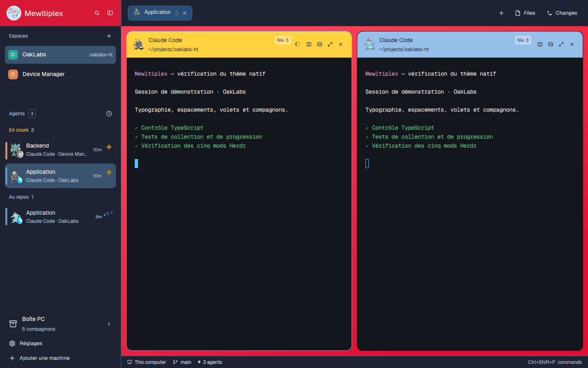
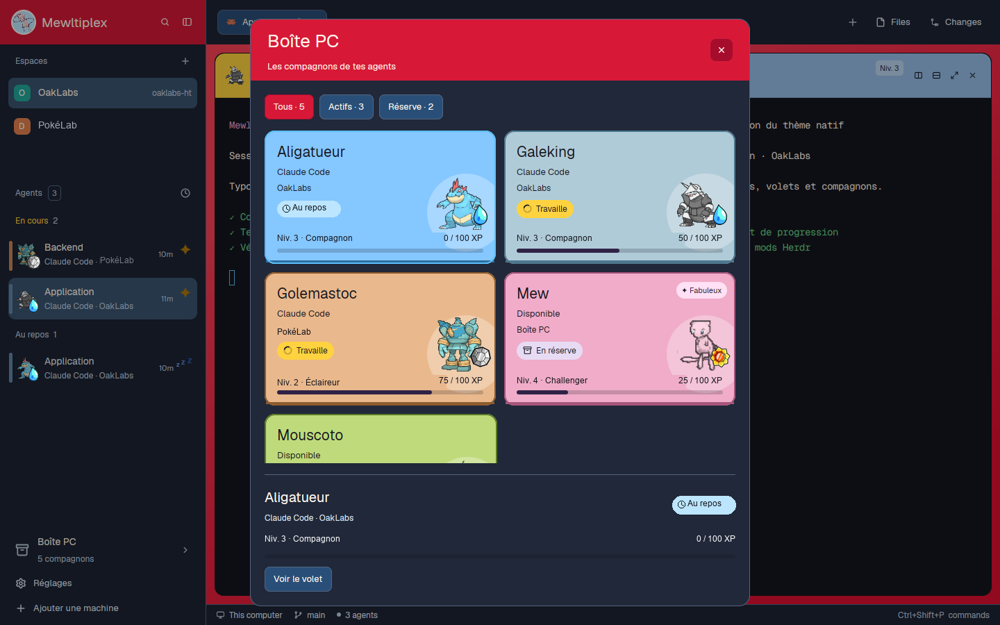

# Pokemon Mewltiplex

[Français](README.fr.md)

**Your agents progress. So do their Pokémon.**

Pokemon Mewltiplex gives [Herdr](https://herdr.dev/) a Pokédex-inspired look: a bright red frame, spaces that are easy to scan, and a Pokémon companion for each agent. The installed layout is named **Mewltiplex** and follows the app's light or dark appearance.



[See light mode](preview-paper.png) · [Explore the PC Box](preview-box.png)

## A little play in the workday

- **One Pokémon per agent**, chosen from 1,025 species. Its sprite follows the agent through the sidebar, tabs, panes and notifications.
- **Statuses at a glance**: `!` for completed work, `?` when an agent needs you, `✦` while it works and `zzz` at rest.
- **Automatic progress**: completed turns earn XP and unlock ten milestones, up to Pokémon League Champion.
- **A PC Box** to see active and reserve companions and reassign one to another agent.



The previews use fictional data and were composed locally from Herdr captures.

## Installation

Requires **Herdr App 0.1.16 or later** on Windows, macOS or Linux.

### With an agent

Give it this instruction:

```text
Read AGENTS.md in my Herdr App profile, then install Mewltiplex
from https://github.com/Skilldus/oaklabs-ht following its README.
```

### From the repository

Clone the repository and run the appropriate script from its root, with `herdr-app` available in your terminal:

**Windows · PowerShell**

```powershell
powershell.exe -NoProfile -ExecutionPolicy Bypass -File .\install.ps1
```

**macOS and Linux**

```sh
sh ./install.sh
```

If Herdr is open, the installer activates Mewltiplex. Otherwise, select it next time under **Settings → Look → Layout**. Select **Herdr** there to return to the original interface.

To update, run `git pull --ff-only` in the repository and rerun the installation script.

## Explore

Click **Mew** in the header or **PC Box** at the bottom of the sidebar. Sprites download on first use and remain available offline; Pokédex descriptions are included with the layout.

See the [recipe](RECIPE.md) for the design brief and compatibility details, and [NOTICE](NOTICE) for sources and attribution.
