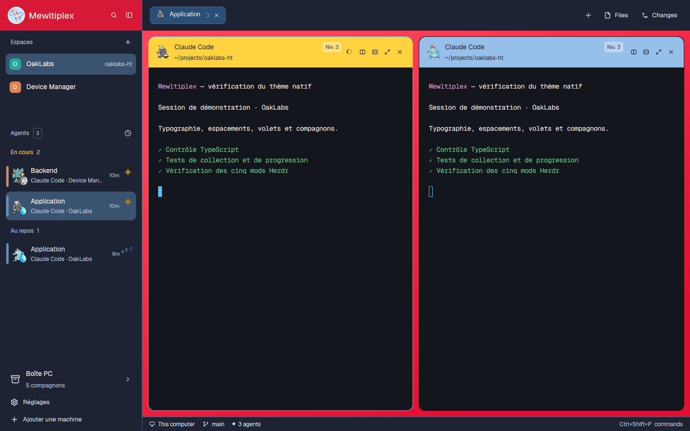

# Pokemon Mewltiplex

A Pokédex-inspired layout for Herdr. Each coding agent gets a Pokémon companion, and a bright red frame brings spaces, agents and terminals together in one window. The layout follows Herdr's light or dark appearance.

## The experience

The left sidebar keeps spaces and agents easy to scan. Agent rows show their companion, current activity and where they are working. Tabs and terminal headers carry the same visual language, while Herdr's native terminals, Files panel, Changes panel and status bar remain available.

Mew opens a **PC Box** with active companions and those kept in reserve. A companion stays with its agent across space and status changes; finished turns earn experience once and unlock visual milestones. A companion can later be reassigned to another agent without losing its progress.

Status symbols distinguish work in progress, requests for help, completed work and rest without relying on colour alone. The sidebar and pane controls adapt when space is tight. The interface uses rounded cards, playful type, Pokémon type colours and a cream or slate palette according to the active appearance.

## Building it

Start with Herdr's main layout. Keep its workspace and terminal behaviour, then provide custom mods for the brand area, spaces list, agents list and PC Box, tabs, pane headers and notifications. The layout points to those mods and to two matching themes. Let the user switch back to any other Herdr layout at any time.

Give each agent a stable companion identity and persist its experience separately from the current UI state. Use Herdr's terminal turn information to award progress once per completed turn. Show a program icon or initial whenever a sprite is unavailable.

The sprites come from a pinned revision of the [PokéAPI sprites repository](https://github.com/PokeAPI/sprites). Download them on first use, verify them against the included SHA-256 manifest and cache them for offline use. The Pokédex text and other assets travel with the layout. See [NOTICE](NOTICE) for sources and attribution.

## Files and requirements

- `layouts/Mewltiplex.json` defines the window. Its installed name remains **Mewltiplex**.
- `themes/` contains the light and dark palettes.
- `mods/` contains the five mods used by the layout; `src/` holds their editable sources.
- `preview.png` shows the layout with fictional data. `preview-paper.png` and `preview-box.png` show the alternate appearance and PC Box.

Use Herdr App 0.1.16 or later. The mods download sprites over HTTPS and run local commands to verify their hashes, manage the cache and read Git or machine information for the spaces list. Installation instructions for Windows, macOS and Linux are in the [README](README.md).
